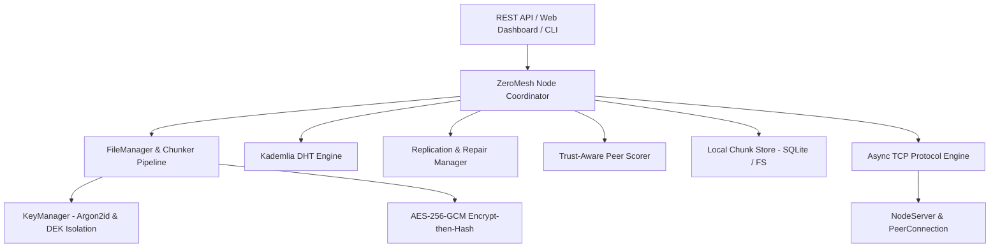

# ZeroMesh Design & Architecture Specification

**Course**: Computer Networks (20MSS52)  
**System**: Trust-Aware Decentralized P2P Encrypted File System  

---

## 1. System Architecture

ZeroMesh is designed as a layered decentralized peer-to-peer architecture:



---

## 2. Cryptographic Security Model

### 2.1 Key Separation & Storage Isolation
1. **Passphrase-derived KEK**: Derived using Argon2id (`time_cost=3`, `memory_cost=64MiB`, `parallelism=4`).
2. **Per-file DEK**: 256-bit random AES key generated via CSPRNG (`secrets.token_bytes(32)`).
3. **Key Wrapping**: The DEK is encrypted using the KEK via authenticated AES-256-GCM.
4. **Peers Isolation**: Remote chunk-storing peers NEVER receive encryption keys, file manifests, or passphrases.

### 2.2 Encrypt-then-Hash Content Addressing
- Each plaintext chunk $P_i$ is encrypted: $C_i = \text{AES-256-GCM}(K_{DEK}, P_i, \text{nonce}_i)$.
- Content ID: $\text{CID}_i = \text{SHA-256}(\text{nonce}_i \parallel C_i)$.
- **Benefit**: Storage peers verify chunk integrity without possessing decryption keys, closing the plaintext oracle vulnerability.

---

## 3. Trust-Aware Peer Scoring (Project Differentiator)

### 3.1 Composite Score Formulation
Each peer's reliability score $S \in [0.0, 1.0]$ is computed as:

$$S = w_{\text{rtt}} \cdot S_{\text{rtt}} + w_{\text{success}} \cdot S_{\text{success}} + w_{\text{recency}} \cdot S_{\text{recency}} + w_{\text{streak}} \cdot S_{\text{streak}} + w_{\text{integrity}} \cdot S_{\text{integrity}}$$

Default weights:
- $w_{\text{rtt}} = 0.30$: Exponentially Weighted Moving Average (EWMA) of RTT.
- $w_{\text{success}} = 0.30$: Historical ratio of successful message exchanges.
- $w_{\text{recency}} = 0.15$: Exponential time decay ($t_{1/2} = 3600\text{s}$).
- $w_{\text{streak}} = 0.10$: Streak penalty for consecutive failures ($e^{-0.5k}$).
- $w_{\text{integrity}} = 0.15$: Penalizes corrupted chunk delivery.

### 3.2 Integrity Penalties & Blacklisting
- A single corrupted or tampered chunk triggers an immediate integrity penalty ($S_{\text{integrity}} \leftarrow 0$).
- Peers exceeding the failure threshold are placed on a 5-minute dynamic blacklist ($S = 0.0$, skipped in replica placement and retrieval).

---

## 4. Replication, Health Audits & Repair

### 4.1 Replica Placement
- Chunks are distributed to the $k$ closest DHT peers ranked by their trust score, bypassing blacklisted or flapping nodes.

### 4.2 Challenge-Response Health Audits
- To verify remote data possession without re-downloading whole chunks, a node challenges peer $j$ with a random nonce $N_{\text{audit}}$:
$$\text{Proof} = \text{SHA-256}(\text{nonce}_i \parallel C_i \parallel N_{\text{audit}})$$
- The verifier computes the hash locally and validates proof authenticity in $O(1)$ time.

---

## 5. Wire Protocol & Network Framing

### 5.1 Framing Layout
```
┌────────────────────┬─────────────────────┬────────────────────────────────────┐
│ Length (4B, uint32)│ MsgType (1B, uint8) │ Payload (variable bytes, msgpack)  │
└────────────────────┴─────────────────────┴────────────────────────────────────┘
```
- Maximum frame size: 4 MB (enforced on wire read to prevent buffer-exhaustion attacks).
- Strict schema validation enforced before message dispatch.

